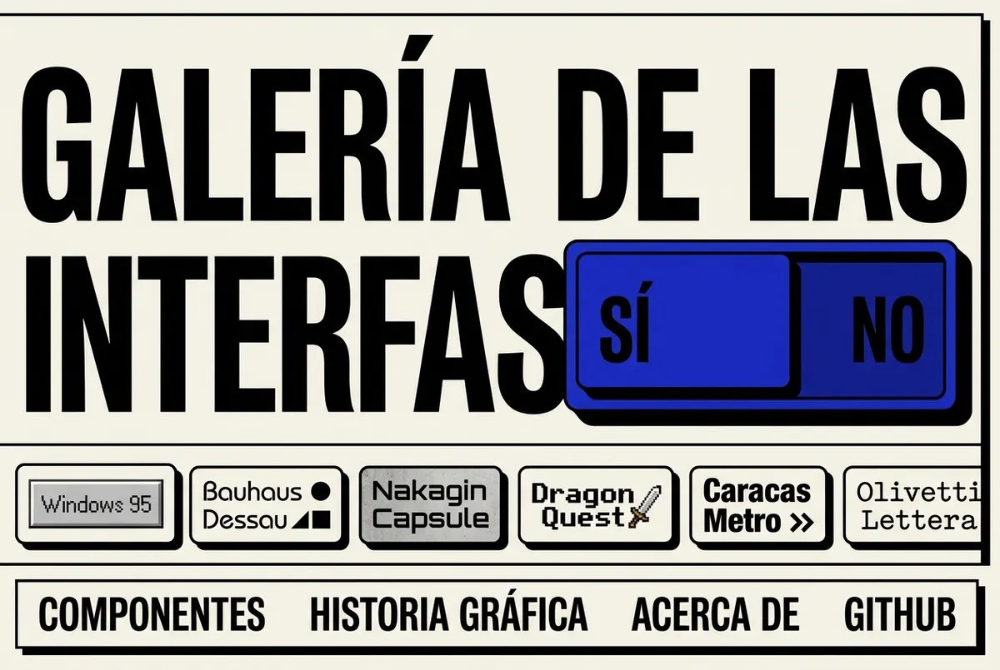

# neobrutalistcomponents · The home page as a monument — Design

**Date:** 2026-10-11
**Owner:** Samuel Ballesteros (SDB)
**Author:** Claude, brainstormed with the owner in an interactive session. Each section below was presented and approved one at a time.
**Status:** Draft for owner review. Replaces the home page of `2026-10-05-neobrutalism-study-engine-design.md` (§ the gallery home). The study engine, the fichas and every other page stay as they are, except the shared header on phones (§6).

---

## 1. Intent (in the owner's words)

> "vale como podemos mejorar nuestra galeria? yo creo que podemos hacerlo mucho mejor"
> "visualmente quiero que sea mucho mas impresionante y atractiva"

A first round of proposals (a wall of works, an original-versus-homage stage, a timeline) was rejected: "no me gusta ninguna de las propuestas". A benchmark of 29 competitor sites followed (§2), then a throwaway GSAP gallery prototype ("creo que lo podriamos hacer mejor"), then three concept images from Gemini. The owner picked one: "toma Monumento como base para el rediseño de la homepage (quitale solo el elemento azul) parte de ahi".

Decisions the owner took, in order:

| Question | Owner's answer |
|---|---|
| Base | **The «Monumento» concept** (§3), without its blue switch. |
| What a work's chip does | **Repaints everything.** The whole site takes the work's theme, and the giant title is reset in the work's lettering. |
| How many chips and how they move | **A moving ribbon** of all the themes, which stops under the pointer. |
| What follows the monument | **Components, the work, take it:** a wall of real components in the active theme, the work's card with its provenance, then installation. The current essay moves to its own page. |
| First screen, below the fold, mobile, build | Approved as presented ("perfecto", "perfect"). The owner asked for the mobile view to be designed in the same pass. |

What was *assumed* and is stated here for the owner to correct:
- The first visit opens in `classic`, as today, and a returning visitor sees the theme they chose last (today's `useSitePrefs` behaviour).
- The language link and the colour-scheme select, which the concept image does not show, sit as one quiet line in the monument's top-right corner on desktop and in the menu on phones.
- The ribbon order is by date: the five house themes first (they have no date), then the study works from the oldest (Lotería, 1887) to the newest.
- No «Al azar» chip: the owner chose the ribbon option, which did not include one. It can come later.
- **One change from what was presented:** Part 4 said the ribbon would be a CSS animation using only `transform`. Writing the spec showed that a transform loop cannot also be dragged with a finger, which the approved mobile part requires. The ribbon is therefore a native horizontal scroller that a script advances (§7.3).

## 2. What the competition does (benchmark, 2026-10-11)

Four researchers opened 29 sites in four groups: neobrutalist libraries (neobrutalism.dev, RetroUI, 8bitcn, BoldKit, BRUT/UI), period-interface libraries (98.css, XP.css, 7.css, system.css, NES.css, React95, os-gui and others), theme galleries (tweakcn, shadcn themes, daisyUI, ui.jln.dev, Radix playground, shadcn/studio) and the most admired library sites (shadcn, Aceternity, Magic UI, React Bits, HeroUI, Origin UI, Animata, Motion Primitives).

What nearly all of them do, and this design adopts:
- A one-line headline and real components on the first screen.
- **One composition and one switch that repaints the whole site** (5 of 6 theme galleries). None repeats the same form once per theme, which our current home does 34 times.
- Themes as small named chips; a copyable command or "copy CSS" to take a theme.

What none of them does, and this design keeps as ours:
- Say where a theme comes from: work, author, year, sources (0 of 29).
- Change border, shadow and corner language between themes; they all recolour one rounded layout.

## 3. The reference image

What we take: a heavy-bordered plate with a hard shadow; the name in a heavy condensed grotesque filling the width; a row of chips, each in its work's own style, cut off at the right edge; a bottom bar of links in the same heavy type; off-white paper and black ink.

What we drop: the blue switch (the owner's call), the misspelling «INTERFAS», and the chips' invented artwork. The image is an AI concept, not content. Every chip is drawn from the catalog's own tokens.

## 4. The first screen (desktop)

### 4.1 The plate
The first screen is one plate inside the page margin, painted with the active theme's tokens: background, border width and colour, hard shadow, corner radius. In `classic` it is paper and black ink, as in the image. In `dragon-quest` it becomes a white rounded frame on black. The plate is at least the viewport's height minus the page margin, so the ribbon and the bottom bar sit on the first screen at 1280×720 and above.

### 4.2 The title
- Text: «GALERÍA DE LAS INTERFACES» (ES), «GALLERY OF INTERFACES» (EN), always upper case.
- Lines on desktop: ES «GALERÍA DE LAS» / «INTERFACES»; EN «GALLERY OF» / «INTERFACES».
- **Each line is fitted to the plate's inner width**, so the lines differ in size, as on a poster.
- Type: `font-family: var(--nbc-font-display)`, `font-weight: var(--nbc-weight-display)`, `font-stretch: 75%`. The stretch only affects variable fonts with a width axis. `classic` already loads Bricolage Grotesque with `wdth 75..100` and has `--nbc-weight-display: 800`, which gives the image's heavy condensed look without a new font. Other themes show their own display face, which is the point of the repaint.
- The title is the page's `<h1>`.

### 4.3 The ribbon
- One chip per catalog entry: 34 today, the 5 house themes and 29 study works. The count comes from the catalog.
- A chip shows the theme's short name (`entry.name[lang]`, or `THEME_INFO[id].name` for house themes) in that theme's display font. It is painted with that theme's tokens: background, foreground, border, shadow, radius.
- A chip is a `<button>` with `aria-pressed` for the active theme. Its accessible name is «Dragon Quest, 1986: usar este tema» / «Dragon Quest, 1986: use this theme». House themes have no year.
- The active chip shows a thick outline in the plate's foreground colour.
- The ribbon drifts left at about 40 px/s. It stops while the pointer is over it or focus is inside it.
- It is cut at the plate's right edge. A left fade shows that it continues.

### 4.4 The work line
Under the ribbon, one line names the active theme:
- Study work: «Dragon Quest · Yuji Horii, Koichi Nakamura y equipo · 1986 · Ver la obra →». Authors are listed up to two, then «y equipo» / «and team». Years come from `reference.date`, formatted as on the work page.
- House theme: «Classic · Tema de la casa · Ver el tema →» / «Classic · House theme · See the theme →».
- The link goes to `#/{lang}/theme/{id}`. The line is a polite live region, so a screen reader hears the new work after a chip is pressed.

### 4.5 The bottom bar
A bordered bar at the bottom of the plate, in the title's heavy type at a reading size: Componentes · Salas · Archivo · Librería · GitHub (EN: Components · Rooms · Archive · Library · GitHub). It is a `<nav>` with its own label. The home has no other navigation on its first screen. The quiet top-right line holds the language link and the colour-scheme select (§1, assumed).

### 4.6 Changing theme
A chip calls the existing `onPrefsChange({ theme })`. That change already runs in a View Transition, is saved to localStorage and is mirrored in `?theme=`. The whole site repaints. The title then resets letter by letter: each letter fades and rises 0.2 em, 18 ms apart, about 0.4 s in total. Under `prefers-reduced-motion: reduce` there is no View Transition (as today), no cascade and no ribbon drift.

## 5. Below the monument

### 5.1 The wall of components
- Heading: «Los mismos componentes, en el idioma de Dragon Quest» / «The same components, in the language of Dragon Quest». For a house theme it reads «…, en el tema Classic».
- A bento grid of real, working components in the active theme. **All 16 components appear at least once:** Alert, Badge, Button, Card, Checkbox, Dialog, Input, Kbd, Progress, RadioGroup, Select, Switch, Table, Tabs, Textarea, Tooltip.
- The blocks speak about the gallery:
  - a card «¿Colgar esta obra en tu sitio?» whose Colgar button opens the real Dialog, which holds the install lines;
  - a Table of the works in the active theme's room, with their years (for a house theme, the oldest work of each of the five rooms);
  - a settings Card with Tabs, a Select, a Switch, Checkboxes and a RadioGroup;
  - a Progress, an Alert, Badges, `Ctrl K` in Kbd, a Tooltip, and an Input with a Textarea.
- Each block carries a small link to its component page («Dialog →»).
- It replaces `GalleryPiece` on the home only. `GalleryPiece` stays where it is used elsewhere.

### 5.2 The work's card
A horizontal card about the active theme, in three variants:
- **Work with a free image:** the photograph with its credit line (author, licence, source), as on the work page.
- **Work without one: a documentary plate.** The documented colours from the ficha's palette block as swatches with their names, and the name of the original lettering from the ficha's lettering block. It is labelled «Lámina documental: no hay una imagen libre de esta obra» / «Documentary plate: there is no free image of this work».
- **House theme:** «Tema de la casa» / «House theme» and the theme's tagline. No image.

Beside the image (study works): name, authors, date and place, the tagline, a count of sources («12 fuentes» / «12 sources»), and «Leer la ficha completa →» / «Read the full record →».

Name, authors, date, place and tagline come from the catalog. The sources, the palette and the lettering live in the ficha chunk, which is loaded lazily once the card nears the viewport.

### 5.3 Take it
- `npm install neobrutalistcomponents` with a copy button.
- The theme's import lines with a copy button. These are today's `installCode(id, fonts)` from `ThemePage.tsx`, moved to a shared module so both pages use one source.
- «Copiar CSS» / «Copy CSS» copies the theme's stylesheet, the same file the package ships as `themes/{id}.css`.
- A link to the agents guide.

### 5.4 Footer and the essay
- The home's essay (`<Essay slug="home" />`) moves to a new page, «Sobre la galería» / «About the gallery», at `#/{lang}/about`.
- The footer gains a link to it. The rest of the footer is unchanged.

## 6. Mobile (designed for 390 px, holding to 360 px)

### 6.1 The bar, site-wide
- Below 640 px, every page's header becomes one 48 px bar: the «nb» mark on the left and a «Menú» / «Menu» button on the right.
- The button opens a sheet built on the library's own `Dialog`. The sheet holds the primary navigation, the theme switcher, the colour-scheme select, the language link and GitHub. Escape and the close button dismiss it, and focus returns to «Menú».
- Today's five-row header (about 270 px) is gone on phones.

### 6.2 The home's first screen on a phone
From the top:
1. The 48 px bar.
2. The plate, 16 px from each edge.
3. The title on three lines: ES «GALERÍA» / «DE LAS» / «INTERFACES», EN «GALLERY» / «OF» / «INTERFACES».
   - The first and last lines are fitted to the width.
   - The middle line is a connector. It is set at the smaller of the two fitted sizes and aligned left, so «DE LAS» does not become the largest line.
4. The ribbon, with chips at least 44 px tall.
   - It drifts on its own and stops while a finger is on it. It resumes 3 s after the finger lifts.
   - A finger can drag it either way. Tapping a chip repaints everything.
5. The work line, at most two lines.
6. The bottom bar as a 2×2 grid of large buttons: Componentes, Salas, Archivo, Librería. GitHub lives in the menu.

All of it fits in the first screen of a 390×844 phone.

### 6.3 Below, in one column
- The wall stacks: the Dialog card, the Table (work and year only), the settings card, then the small blocks. The Tooltip opens on tap.
- The work's card puts the image on top at full width and the text below it.
- In «Llévatelo» each command scrolls inside its own block, and the copy buttons are full width.
- The footer stacks.

### 6.4 Rules
- No horizontal page scroll at 360 px.
- Touch targets of at least 44 px.
- axe clean.
- Under reduced motion the ribbon stands still and is scrolled by hand.

### 6.5 Desktop header
- On the home, desktop has no top header while the plate is on screen. A slim fixed bar appears once the plate's bottom bar leaves the viewport: the mark, the primary navigation, the language link and GitHub. An IntersectionObserver watches the plate's bottom bar.
- Other pages keep today's desktop header.

## 7. Architecture

### 7.1 New files, in `src/site/home/`
| File | One job |
|---|---|
| `Monument.tsx` | The plate: corner line, title, ribbon, work line, bottom bar. |
| `FitTitle.tsx` | Renders the title's lines and fits each to the container's width (§7.2). |
| `ThemeRibbon.tsx` | The chips and the drift (§7.3). |
| `ComponentWall.tsx` | The bento of components (§5.1). |
| `WorkCard.tsx` | The work's card in its three variants (§5.2). |
| `TakeIt.tsx` | Install, imports, Copy CSS (§5.3). |

Changed:
- `src/site/pages/StudyHome.tsx` is rewritten from the pieces above. `TimelineWork`, `WorkStage` and the 34-row chronology leave the home.
- `src/site/Shell.tsx` gets the phone bar and its menu sheet (§6.1), and the home's slim desktop bar (§6.5).
- `src/site/router.ts` gets the `about` route, and a new `src/site/pages/About.tsx` renders the essay.
- `src/site/i18n.ts` gets every new string in ES and EN.
- `installCode` moves from `ThemePage.tsx` to `src/site/install.ts`.
- `src/site/site.css` gets the new styles. No new dependency.

### 7.2 Fitting the title
- Each line is a `` measured at a reference size of 100 px. Its font size is set to `100 × containerWidth / measuredWidth`.
- It re-measures:
  - on container resize (a `ResizeObserver`);
  - after `document.fonts.ready`;
  - after the active theme's fonts load.
- A phone connector line takes the smaller of its neighbours' sizes.
- Before the first measurement, CSS `clamp()` sizes keep the layout from jumping.

### 7.3 The ribbon
- The chips sit in a horizontally scrolling track (`overflow-x: auto`, scrollbar hidden visually, still keyboard-scrollable). The chip list is rendered twice. The second copy is `aria-hidden` and its buttons have `tabIndex={-1}`.
- A `requestAnimationFrame` loop advances `scrollLeft` at 40 px/s. When it passes the first copy's width, it subtracts that width, so the loop never shows a seam.
- The loop pauses on `pointerenter`, `focusin` and `touchstart`. It resumes on `pointerleave` and `focusout` when focus leaves the track, and 3 s after `touchend`.
- It never runs under `prefers-reduced-motion: reduce`, or while the page is hidden (`visibilitychange`).
- Chips paint with the catalog's `vars`, set inline, so no theme stylesheet is fetched. House themes are always loaded. This is the same island approach as the Archivo's `ThemeCard`.
- Each chip's display font is requested from Google Fonts with `&text=` limited to that chip's label: a few KB per chip. A small helper derives that URL from `entry.fontsHref` and hands it to the existing `loadFonts`.

### 7.4 Data flow
1. A chip is pressed.
2. `onPrefsChange({ theme })` runs, as today (View Transition, localStorage, `?theme=`).
3. `<html data-theme>` changes and the active stylesheet loads through the existing loader.
4. `FitTitle` re-fits once the new fonts are ready.
5. The title cascade plays. The work line announces the new work.
6. The wall and the work card re-render in the new theme.

## 8. When something fails
- A chip's or a theme's font does not load: the title falls back along the theme's font stack and re-fits.
- The ficha chunk does not load: the card shows what the catalog has (name, authors, date, place, tagline) and the link to the work page, without the source count or, on a documentary plate, the swatches.
- The clipboard is unavailable: the code block selects its own text and the button reads «Selecciona y copia» / «Select and copy».
- «Copiar CSS» cannot fetch the stylesheet: the button reports it and the import lines stay usable.

## 9. Accessibility and motion
- One `<h1>` (the title). The ribbon is a group labelled «Temas» / «Themes». The bottom bar and the slim bar are `<nav>` landmarks with distinct labels.
- Chips are buttons with `aria-pressed`. The duplicate copy is hidden from assistive technology and from tab order.
- The work line is `aria-live="polite"`.
- Every animation stops under reduced motion: the ribbon drift, the title cascade and the View Transition.
- Contrast is checked by axe in `classic` and in `dragon-quest`.
- Focus is visible on chips in every theme. The outline uses the plate's foreground colour, never the chip's own.

## 10. Testing
- **Unit tests** (Vitest and Testing Library):
  - `FitTitle` sets each line's size from a mocked measurement, and the connector line takes the smaller size.
  - The ribbon renders one chip per catalog theme, and the active chip is `aria-pressed`. A click calls `onPrefsChange` with that id. It does not advance under reduced motion or while focus is inside. The duplicate copy is `aria-hidden` and untabbable.
  - The work line names authors (two, then «y equipo»), years, and the house-theme variant.
  - `WorkCard` covers its three variants.
  - `installCode` gives the same output from its new home. `ThemePage` still shows it.
  - The router handles `/about` in both languages.
- **End-to-end** (Playwright), in `classic` and in `dragon-quest`:
  - axe at 360 px and at 1280 px;
  - no horizontal scroll at 360 px;
  - clicking a chip changes `<html data-theme>` and `?theme=`;
  - the title has one line per expected break;
  - the phone menu opens and closes with the keyboard, and Escape returns focus to «Menú»;
  - under reduced motion the ribbon's `scrollLeft` does not change on its own;
  - the slim desktop bar appears after scrolling past the plate.
- The existing e2e specs that walk the old home (the 34-row chronology, the essay on the home) are updated to the new home and the About page.

## 11. Out of scope (later deliveries)
- The drawn homages per work type (window, poster, sign, specimen, product card) for works without a free image.
- Redesigning the work page itself.
- Walkable tours, comparing two works, the element browser, the timeline.
- An «Al azar» chip.
